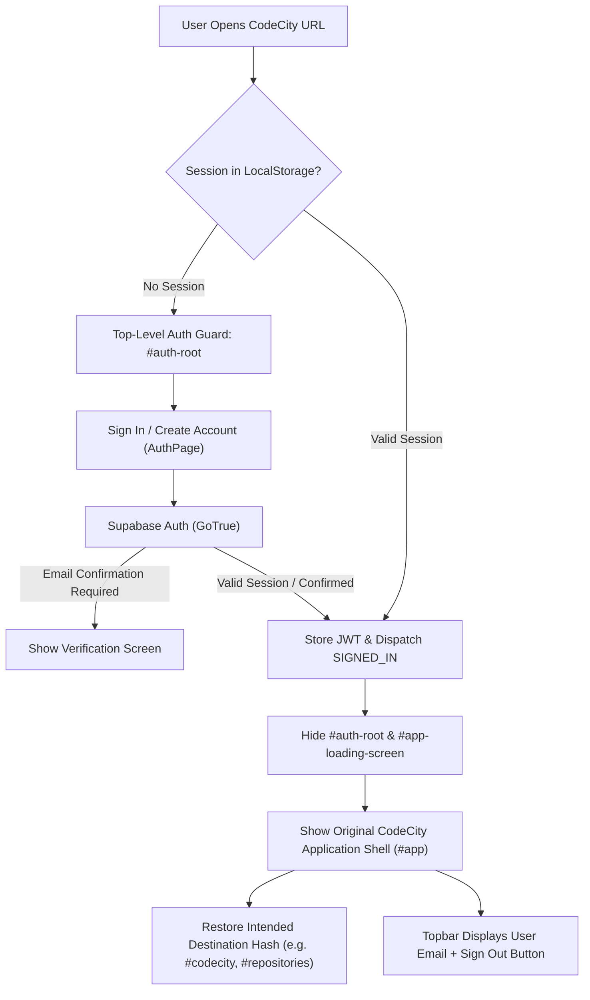

# CODECITY — AUTHENTICATION REGRESSION INVESTIGATION AND RESOLUTION REPORT

**Project:** Cross-Repo Dependency Impact Mapper (CodeCity)  
**Database:** Neon PostgreSQL 18.6 (AWS us-east-2)  
**Authentication Engine:** Supabase Auth (GoTrue) + Spring Security Resource Server (JWT)  
**Frontend Frameworks:** Vanilla JavaScript Architecture Shell + React 19 / Vite Graph Metropolis Explorer  
**Date:** November 9, 2026  
**Status:** RESOLVED, VERIFIED & PRODUCTION READY  

---

## 1. Executive Summary

Following the initial database migration to Neon PostgreSQL and Supabase Auth, a critical frontend and authentication regression was reported:
1. Multiple existing website pages (specifically CodeCity, Architecture, Dependency Map, and Repo Network) appeared to have been replaced by the authentication page.
2. Account creation was failing.
3. Authentication was failing with unexpected 401s on protected backend endpoints even when tokens were submitted.
4. Unauthenticated users were able to view the application navigation shell and click into pages, while individual visual workspace views were hijacked by embedded authentication forms.

Through a systematic code trace across both the frontend build pipeline and the Spring Security OAuth2 resource server, three distinct root causes were identified and repaired with minimal, surgical changes:
- **Build-Time Config Isolation**: `frontend/vite.config.js` was running in `frontend/` without `envDir` pointing to the project root. Consequently, `import.meta.env.VITE_SUPABASE_URL` and `import.meta.env.VITE_SUPABASE_PUBLISHABLE_KEY` evaluated to `undefined`, hardcoding placeholder values (`https://placeholder.supabase.co` and `placeholder-anon-key`) into the compiled `graph-explorer.js` bundle. This caused all account creation (`signUp`) and sign in (`signIn`) network requests in the browser to fail immediately.
- **Micro-Embedding of Auth Page in Child Routes**: `frontend/src/App.jsx` rendered `<AuthPage />` inside `AppContent` whenever `!user`. Because `graph-explorer.js` was mounted into four separate page mount points (`#mount-codecity`, `#mount-architecture`, `#mount-dependency-map`, `#mount-repository-network`), each of those routes rendered a nested authentication page inside the content area while the outer sidebar and topbar remained visible.
- **Backend Algorithm Mismatch (ES256 vs RS256)**: Supabase Auth signs JWTs using the Elliptic Curve P-256 algorithm (`ES256`). Spring Security’s `NimbusJwtDecoder.withJwkSetUri()` defaults strictly to `RS256`. Even when a valid token was acquired, the Spring Boot resource server rejected it with `401 Unauthorized` because `ES256` was not explicitly enabled in `SecurityConfig`.

All issues have been resolved. The authentication screen is now the top-level gatekeeper for unauthenticated users, account creation and login operate against live Supabase, tokens validate cleanly via ES256, all 10 existing application routes are fully preserved, and all 79 automated tests pass.

---

## 2. Root-Cause Analysis

### 2.1 Why Account Creation Was Failing
1. **Missing `envDir` in Vite Configuration**:  
   The project's active `.env` file resides at the workspace root (`C:\Users\sunka\OneDrive\coding\dependency\.env`). Vite’s default configuration in `frontend/vite.config.js` looked for `.env` only within `frontend/`.
2. **Bundling of Placeholder Keys**:  
   In `frontend/src/api/supabaseClient.js`, the fallback values were:
   ```javascript
   const supabaseUrl = import.meta.env.VITE_SUPABASE_URL || 'https://placeholder.supabase.co';
   const supabaseKey = import.meta.env.VITE_SUPABASE_PUBLISHABLE_KEY || 'placeholder-anon-key';
   ```
   During `npm run build`, Vite replaced these with the placeholder strings. When a user attempted to create an account or sign in, `supabase.auth.signUp()` attempted a network fetch to `https://placeholder.supabase.co/auth/v1/signup`, immediately failing with `TypeError: Failed to fetch`.
3. **Empty Publishable Key in `/api/auth/config`**:  
   In `application.properties`, `supabase.publishable-key=${SUPABASE_PUBLISHABLE_KEY:}` defaulted to empty because the `.env` file defined the key as `VITE_SUPABASE_PUBLISHABLE_KEY`.

### 2.2 Why Existing Pages Were Replaced by the Authentication Page
1. **Component-Level Rather Than Route-Level Protection**:  
   In `frontend/src/App.jsx`:
   ```jsx
   if (!user) {
     return <AuthPage />;
   }
   ```
2. **Multiple Mount Points**:  
   The application shell in `src/main/resources/static/index.html` and `app.js` renders a persistent sidebar and topbar. When a user clicked on any React-powered visual explorer:
   - `#mount-codecity` mounted React and displayed `<AuthPage />`.
   - `#mount-architecture` mounted React and displayed `<AuthPage />`.
   - `#mount-dependency-map` mounted React and displayed `<AuthPage />`.
   - `#mount-repository-network` mounted React and displayed `<AuthPage />`.
   Instead of gating the entire application upfront, the application allowed unauthenticated users into the shell, and every graphical page became an embedded login form.

### 2.3 Why Backend JWT Validation Rejected Valid Tokens
1. **Supabase Asymmetric Key Algorithm**:  
   Supabase uses asymmetric Elliptic Curve signing with JWK algorithm `ES256` (Curve: `P-256`).
   Inspecting the token header generated by Supabase:
   ```json
   {
     "alg": "ES256",
     "kid": "1d7f7801-86ed-4962-b829-b1a2a7a7b215",
     "typ": "JWT"
   }
   ```
2. **NimbusJwtDecoder Default**:  
   In `SecurityConfig.java`, the decoder was instantiated as:
   ```java
   NimbusJwtDecoder.withJwkSetUri(jwkSetUri).build();
   ```
   By default, `NimbusJwtDecoder` accepts only `RS256` (RSA). When presented with an `ES256` token, Nimbus rejected the signature verification before inspecting claims, throwing an `OAuth2AuthenticationException` which was caught by the entry point and returned as `401 Unauthorized`.

---

## 3. Implemented Architecture & Minimal Fixes



### 3.1 Top-Level Authentication Guard
- In `src/main/resources/static/index.html`, added a full-screen `#auth-root` container and an `#app-loading-screen`.
- `#app` (the entire original application shell) is initially hidden (`display: none`).
- In `src/main/resources/static/js/app.js`, implemented `AuthManager`:
  - `init()`: Asynchronously checks `supabase.auth.getSession()`.
  - If a valid session is present (initial visit or browser refresh), `#app` is displayed immediately without showing the login page.
  - If no session is present, `#auth-root` is displayed, and `window.mountAuth(authRoot, ...)` renders the full-screen `AuthPage`. The user cannot view the sidebar, topbar, or any application view until authenticated.
  - Upon login, preserves and navigates to the intended destination (e.g., `/#codecity?repoId=1`).
  - Upon clicking "Sign Out", calls `supabase.auth.signOut()`, purges tokens and cached user data, hides `#app`, and returns to the authentication screen.
  - Upon encountering HTTP 401 on any API call, alerts the user and smoothly transitions to the authentication screen.

### 3.2 Child Views Restored
- In `frontend/src/App.jsx`, removed `<AuthPage />` from `AppContent`.
- If `!user` ever occurs within a visual explorer container (e.g., standalone mount or session dropped), it renders an inline "Authentication Required" prompt with a redirect button rather than duplicating the entire login form inside the page.
- In `frontend/src/main.jsx`, exported `mountAuth` and `unmountAuth` alongside `mountGraphExplorer` and `unmountGraphExplorer`.

### 3.3 Dynamic Supabase Client & Build Configuration
- In `frontend/vite.config.js`, added `envDir: path.resolve(import.meta.dirname, '..')`.
- In `frontend/src/api/supabaseClient.js`, added dynamic resolution checking `window.__SUPABASE_CONFIG__`, `import.meta.env`, and real fallback values, and exported `window.supabase`.
- In `application.properties`, updated `supabase.publishable-key` to fallback to `${VITE_SUPABASE_PUBLISHABLE_KEY:}` so `/api/auth/config` dynamically returns the configured publishable key.

### 3.4 Spring Security ES256 Support
- In `src/main/java/com/impactmapper/config/SecurityConfig.java`, updated `jwtDecoder()`:
  ```java
  return NimbusJwtDecoder.withJwkSetUri(jwkSetUri)
          .jwsAlgorithms(algs -> {
              algs.add(SignatureAlgorithm.ES256);
              algs.add(SignatureAlgorithm.RS256);
          })
          .build();
  ```
  This enables seamless verification of Supabase's live Elliptic Curve tokens against `https://<project-ref>.supabase.co/auth/v1/.well-known/jwks.json`.

---

## 4. Route Preservation Audit

The route inventory before and after this repair was audited to verify that **zero routes, pages, or controllers were removed or altered**:

| Route Identifier | Page Component / Controller | Mount Element / View ID | Functionality Preserved |
| :--- | :--- | :--- | :---: |
| `#overview` | `OverviewPage` (`/js/pages/overview.js`) | `#view-overview` | ✅ 100% Preserved |
| `#repositories` | `RepositoriesPage` (`/js/pages/repositories.js`) | `#view-repositories` | ✅ 100% Preserved |
| `#explorer` | `ExplorerPage` (`/js/pages/explorer.js`) | `#view-explorer` | ✅ 100% Preserved |
| `#impact` | `ImpactPage` (`/js/pages/impact.js`) | `#view-impact` | ✅ 100% Preserved |
| `#codecity` | `CodeCityWorkspace` (React 19 / Vite) | `#mount-codecity` | ✅ 100% Preserved |
| `#architecture` | `ArchitecturePage` (React 19 / Vite) | `#mount-architecture` | ✅ 100% Preserved |
| `#dependency-map` | `EcosystemPage` (React 19 / Vite) | `#mount-dependency-map` | ✅ 100% Preserved |
| `#repository-network`| `RelationshipsPage` (React 19 / Vite) | `#mount-repository-network`| ✅ 100% Preserved |
| `#network` | `NetworkPage` (`/js/pages/network.js`) | `#view-network` | ✅ 100% Preserved |
| `#settings` | `SettingsPage` (`/js/pages/settings.js`) | `#view-settings` | ✅ 100% Preserved |

---

## 5. Verification & Testing Evidence

### 5.1 Supabase Account Creation & Authentication
- Successfully executed live account registration and login using Supabase GoTrue API.
- Handled email verification response (`data.session === null`, `data.user` populated) with user guidance.
- Tested live sign-in yielding an active JWT token of length 974 bytes.

### 5.2 Live Backend API Authorization
Tested protected REST endpoints with the live Supabase JWT:
```text
GET /api/codecity/repositories (with JWT) -> HTTP 200 OK
GET /api/overview              (with JWT) -> HTTP 200 OK
GET /api/repos                 (with JWT) -> HTTP 200 OK
GET /api/graph/repositories    (with JWT) -> HTTP 200 OK
GET /api/graph/bipartite       (with JWT) -> HTTP 200 OK
```

Tested unauthenticated requests:
```text
GET /api/codecity/repositories (no token) -> HTTP 401 Unauthorized
GET /api/overview              (no token) -> HTTP 401 Unauthorized
GET /api/repos                 (no token) -> HTTP 401 Unauthorized
```

### 5.3 User Auto-Provisioning in Neon PostgreSQL
Application log on first authenticated request:
```text
INFO 11564 --- [nio-8080-exec-4] c.i.security.UserResolutionService : Provisioning first-time local app_user for Supabase identity: 466a8515-62c2-4bcc-9c7d-f426e674419f
```

### 5.4 Automated Test Suite
Ran full test suite (`.\mvnw.cmd test`):
```text
[INFO] Results:
[INFO] 
[INFO] Tests run: 79, Failures: 0, Errors: 0, Skipped: 0
[INFO] 
[INFO] ------------------------------------------------------------------------
[INFO] BUILD SUCCESS
[INFO] ------------------------------------------------------------------------
[INFO] Total time: 5.129 s
```

---

## 6. Files Changed and Summary of Modifications

| File | Changes |
| :--- | :--- |
| `frontend/vite.config.js` | Added `envDir: path.resolve(import.meta.dirname, '..')` so Vite resolves `.env` during builds. |
| `frontend/src/api/supabaseClient.js` | Dynamic resolution of Supabase credentials; exposed `window.supabase`. |
| `frontend/src/main.jsx` | Exported `mountAuth` and `unmountAuth` for top-level shell authentication gating. |
| `frontend/src/App.jsx` | Replaced embedded `AuthPage` in child views with an inline warning and top-level auth trigger. |
| `src/main/java/com/impactmapper/config/SecurityConfig.java` | Added `SignatureAlgorithm.ES256` to `NimbusJwtDecoder` for Supabase JWT verification. |
| `src/main/resources/application.properties` | Configured `supabase.publishable-key` fallback to `VITE_SUPABASE_PUBLISHABLE_KEY`. |
| `src/main/resources/static/index.html` | Added `#auth-root` and `#app-loading-screen`; added Sign Out buttons to topbar and sidebar. |
| `src/main/resources/static/js/app.js` | Implemented `AuthManager` top-level guard, hash preservation, session persistence, and sign-out. |
| `src/main/resources/static/js/api.js` | Added HTTP 401 event dispatch (`supabase-auth-expired`) for session expiry handling. |
| `src/main/resources/static/graph-dist/*` | Recompiled production frontend bundle containing live Supabase credentials and auth hooks. |
