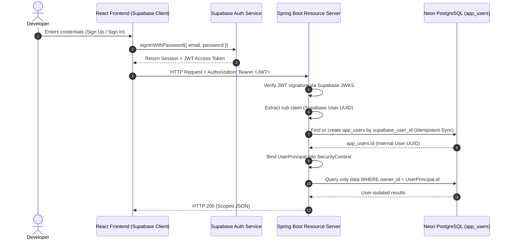

# CODECITY — DATABASE & AUTHENTICATION MIGRATION AUDIT
## Migration from MySQL 8 to Neon PostgreSQL & Supabase Multi-User Authentication

**Audit Date:** 2026-11-08  
**Target Environment:** Neon PostgreSQL + Supabase Auth + Spring Boot 3.2.5 OAuth2 Resource Server  
**Current Baseline Commit:** `a8d8ba0` on branch `feature/neon-supabase-multiuser`

---

## 1. Executive Summary

This audit establishes the technical baseline, compatibility requirements, and transition plan for migrating CodeCity from a single-tenant MySQL 8 database to **Neon PostgreSQL** and integrating **Supabase Authentication** with per-user data ownership.

The existing application is verified healthy and operational:
- **11 JPA Entities** actively mapped in MySQL `impact_mapper_db`.
- **13 Repositories**, **1,603 Dependencies**, **29 Snapshots**, **10,501 Architecture Nodes**, **25,868 Architecture Edges**, **21 City Layouts**, **969 Endpoints**, **969 Static Execution Paths**, **19,143 Static Execution Steps**, and **1 Runtime Trace** (with 2 spans).
- **0 User Entities or Authentication Mechanisms** currently exist: the backend operates completely unauthenticated; all endpoints are publicly accessible; data is shared globally.
- **GitHub API Integration** currently relies on a single server-wide personal access token hardcoded in `application.properties` with fallback to unauthenticated public rate limits.
- **Visual Design & City Layouts**: Fully functional warm-neutral palette and 2D metropolis geometry must be preserved 100% without regression.

---

## 2. Current Database Architecture & Schema Inventory

### 2.1 Entity Dependency Graph

All data in the application is strictly tree-anchored to the `repositories` table:

```
app_users (New Target Entity: UUID, supabase_user_id)
   │
   └── repositories (Target: add owner_id UUID REFERENCES app_users)
         ├── repo_dependencies (Foreign key: repoId -> repositories.id)
         ├── runtime_traces (Foreign key: repository_id -> repositories.id)
         │     └── runtime_spans (Foreign key: trace_id -> runtime_traces.id)
         └── architecture_snapshots (Foreign key: repo_id -> repositories.id)
               ├── architecture_nodes (Foreign key: snapshot_id -> architecture_snapshots.id)
               ├── architecture_edges (Foreign key: snapshot_id -> architecture_snapshots.id)
               ├── city_layouts (Foreign key: snapshot_id -> architecture_snapshots.id, UNIQUE)
               └── code_endpoints (Foreign key: repository_id, snapshot_id)
                     └── static_execution_paths (Foreign key: endpoint_id, snapshot_id)
                           └── static_execution_steps (Foreign key: path_id -> static_execution_paths.id)
```

### 2.2 Table-by-Table Inventory

| Table Name | Current MySQL Row Count | Primary Key | Foreign Keys | Key Column Characteristics |
| :--- | :--- | :--- | :--- | :--- |
| `repositories` | 13 | `id` BIGINT AUTO_INCREMENT | None | `repo_name` VARCHAR(255) UNIQUE NOT NULL, `description` TEXT, `status_detail` TEXT, `added_at` DATETIME(6), `commit_sha` VARCHAR(255) |
| `repo_dependencies` | 1,603 | `id` BIGINT AUTO_INCREMENT | `repoId` -> `repositories(id)` | Note camelCase `repoId` column name in legacy mapping |
| `architecture_snapshots` | 29 | `id` BIGINT AUTO_INCREMENT | `repo_id` -> `repositories(id)` | `analysis_summary` TEXT, `analyzed_at` DATETIME(6), `commit_sha` VARCHAR(255) |
| `architecture_nodes` | 10,501 | `id` BIGINT AUTO_INCREMENT | `snapshot_id` -> `architecture_snapshots(id)` | `annotations_json` TEXT, `node_key` VARCHAR(255), `node_type` VARCHAR(255), `level` INT |
| `architecture_edges` | 25,868 | `id` BIGINT AUTO_INCREMENT | `snapshot_id` -> `architecture_snapshots(id)` | `source_node_key`, `target_node_key`, `relationship_type`, `evidence` TEXT |
| `city_layouts` | 21 | `id` BIGINT AUTO_INCREMENT | `snapshot_id` -> `architecture_snapshots(id)` (UNIQUE) | `buildings_json` **LONGTEXT**, `districts_json` **LONGTEXT**, `roads_json` **LONGTEXT** (Incompatible MySQL type) |
| `code_endpoints` | 969 | `id` BIGINT AUTO_INCREMENT | `repository_id` -> `repositories(id)`, `snapshot_id` -> `architecture_snapshots(id)` | `route_path` VARCHAR(512), `parameters_json` TEXT, `http_method` VARCHAR(16) |
| `static_execution_paths` | 969 | `id` BIGINT AUTO_INCREMENT | `endpoint_id` -> `code_endpoints(id)`, `snapshot_id` -> `architecture_snapshots(id)` | `inferred_summary` TEXT, `has_alternative_branches` BIT(1) |
| `static_execution_steps` | 19,143 | `id` BIGINT AUTO_INCREMENT | `path_id` -> `static_execution_paths(id)` | `call_expression` TEXT, `evidence` TEXT, `is_resolved` BIT(1), `step_index` INT |
| `runtime_traces` | 1 | `id` BIGINT AUTO_INCREMENT | `repository_id` -> `repositories(id)` | `trace_id` VARCHAR(64) UNIQUE NOT NULL, `duration_ms` BIGINT |
| `runtime_spans` | 2 | `id` BIGINT AUTO_INCREMENT | `trace_id` -> `runtime_traces(id)` | `span_id` VARCHAR(64), `attributes_json` TEXT, `has_error` BIT(1) |

---

## 3. Database Compatibility & Incompatibility Analysis

### 3.1 Type & DDL Differences

1. **`LONGTEXT` in `CityLayout.java`**:
   - *MySQL*: Supports `LONGTEXT` (up to 4GB).
   - *PostgreSQL*: `LONGTEXT` is a syntax error (`type "longtext" does not exist`).
   - *Remedy*: Replace `columnDefinition = "LONGTEXT"` with `columnDefinition = "TEXT"` in `CityLayout.java`. In PostgreSQL, `TEXT` has no arbitrary length limit up to 1GB per value.
2. **`BIT(1)` vs `BOOLEAN`**:
   - *MySQL*: Stored booleans as `bit(1)` or `tinyint(1)`.
   - *PostgreSQL*: Native `BOOLEAN` type (`true`/`false`).
   - *Remedy*: Flyway scripts will declare columns as `BOOLEAN DEFAULT FALSE / TRUE`. Hibernate maps Java `Boolean` to PostgreSQL `BOOLEAN` naturally.
3. **Primary Key Generation (`AUTO_INCREMENT` vs `IDENTITY`)**:
   - *MySQL*: Uses `AUTO_INCREMENT`.
   - *PostgreSQL*: Uses `BIGINT GENERATED BY DEFAULT AS IDENTITY` or `BIGSERIAL`.
   - *Remedy*: In Spring Boot 3.2.5 + Hibernate 6, `GenerationType.IDENTITY` generates `GENERATED BY DEFAULT AS IDENTITY`, which is fully standard in PostgreSQL 10+.
4. **Dates and Timestamps**:
   - *MySQL*: Uses `datetime(6)`.
   - *PostgreSQL*: Uses `TIMESTAMP WITHOUT TIME ZONE` or `TIMESTAMPTZ`.
   - *Remedy*: Map `LocalDateTime` to `TIMESTAMP WITHOUT TIME ZONE`.
5. **Identifier Quoting & Case Sensitivity**:
   - *MySQL*: Uses backticks (`` `table` ``).
   - *PostgreSQL*: Uses unquoted lowercase or double quotes (`"table"`).
   - *Remedy*: Use standard unquoted lowercase naming in all SQL migrations and queries.
6. **Unique Constraint on `repositories.repo_name`**:
   - In MySQL, `repo_name` was globally unique.
   - In a multi-user environment, two distinct users might legitimately track the same public GitHub repository (e.g., `spring-projects/spring-petclinic`).
   - *Remedy*: Replace global uniqueness with a composite constraint: `CONSTRAINT uq_user_repo_name UNIQUE (owner_id, repo_name)`.

### 3.2 Query Layer Audit

- **Native SQL Queries**: 0 native SQL queries exist in the codebase.
- **JPQL Queries**: All custom queries in repositories (`CityLayoutRepository`, `CodeEndpointRepository`, `RepoDependencyRepository`, `StaticExecutionPathRepository`) use pure standard JPQL (`DELETE FROM CityLayout l WHERE l.snapshot.id = :snapshotId`, etc.).
- **Spring Data Derived Queries**: Standard method name queries (`findBySnapshotId`, `findByRepositoryIdOrderByRoutePathAsc`, etc.) translate automatically across dialects.
- **Dialect Switch**: Change dialect in `application.properties` from `org.hibernate.dialect.MySQLDialect` to `org.hibernate.dialect.PostgreSQLDialect`.

---

## 4. Authentication, User Identity & Ownership Status

### 4.1 Current Status

- **Zero Authentication**: No Spring Security dependency exists in `pom.xml`. No JWT filter, session manager, or user entity exists.
- **Global Data Visibility**:
  - `GET /api/repos` returns all 13 repositories regardless of caller.
  - `GET /api/overview` aggregates stats across all 13 repositories.
  - `GET /api/graph/bipartite` computes cross-repo dependency couplings across all 13 repositories.
  - `GET /api/dependencies` searches all dependencies globally.
- **Direct ID Traversal (IDOR Risk)**:
  - Any request to `/api/codecity/repositories/{repositoryId}/city` returns the city model without checking who requested it.
  - Anyone can call `DELETE /api/repos/{id}` or `POST /api/repos/{id}/reindex`.

### 4.2 GitHub Credential Model

- **Current Architecture**: Single server-wide token configured as `github.token` in `application.properties`.
- **Current Behavior**: `GitHubService` injects this token into headers via `headers.setBearerAuth(githubToken.trim())`. If missing or if GitHub returns 401, it retries unauthenticated with a 60 req/hr rate limit.
- **Target Architecture**:
  - Keep the server-side token for public repository analysis if needed, but associate user-initiated repository imports with the authenticated user.
  - For private repositories or user-specific rate limits, provide an encrypted user credential field (`user_github_pat` or OAuth integration).
  - Never expose GitHub tokens over REST APIs or log them.

---

## 5. Multi-User Architecture & Security Blueprint

### 5.1 Local Application User Entity (`app_users`)

Create the user anchor table in Neon PostgreSQL:

```sql
CREATE TABLE app_users (
    id UUID PRIMARY KEY DEFAULT gen_random_uuid(),
    supabase_user_id UUID NOT NULL UNIQUE,
    email VARCHAR(255),
    display_name VARCHAR(255),
    created_at TIMESTAMP WITHOUT TIME ZONE NOT NULL DEFAULT NOW(),
    updated_at TIMESTAMP WITHOUT TIME ZONE NOT NULL DEFAULT NOW(),
    last_login_at TIMESTAMP WITHOUT TIME ZONE
);

CREATE INDEX idx_app_users_supabase_id ON app_users(supabase_user_id);
```

### 5.2 User Identity Provisioning Flow



### 5.3 Spring Boot Security Configuration

- Add `spring-boot-starter-oauth2-resource-server` and `spring-boot-starter-security` to `pom.xml`.
- Configure `SecurityFilterChain`:
  - **Public Endpoints**: `/`, `/index.html`, `/favicon.ico`, `/css/**`, `/js/**`, `/graph-dist/**`, `/api/settings/status`, `/actuator/health`.
  - **Protected Endpoints**: All `/api/**` routes require authenticated Bearer token.
  - **Stateless Session**: `SessionCreationPolicy.STATELESS`.
  - **CORS**: Explicit allowed origins (`http://localhost:5173`, `http://localhost:8080`, production domains).
  - **CSRF**: Disabled for stateless Bearer token authentication.

---

## 6. Comprehensive Endpoint Authorization Matrix

| Endpoint | Method | Resource | Ownership Enforcement Rule | Error Response |
| :--- | :--- | :--- | :--- | :--- |
| `/api/repos` | GET | Repository List | `SELECT r FROM Repository r WHERE r.owner.id = :userId` | 401 if unauth |
| `/api/repos` | POST | Create Repo | Assign `owner = currentUser` | 401 if unauth |
| `/api/repos/{id}` | GET | Repository | Verify `repo.owner.id == currentUser.id` | 404 (IDOR shield) |
| `/api/repos/{id}` | DELETE | Repository | Verify `repo.owner.id == currentUser.id` | 404 (IDOR shield) |
| `/api/repos/{id}/reindex`| POST | Repository | Verify `repo.owner.id == currentUser.id` | 404 (IDOR shield) |
| `/api/repos/reindex-all` | POST | Repositories | Reindex only repos where `owner.id == currentUser.id` | 401 if unauth |
| `/api/repos/{id}/architecture` | GET | Architecture | Verify `repo.owner.id == currentUser.id` | 404 (IDOR shield) |
| `/api/repos/{id}/architecture/reindex` | POST | Architecture | Verify `repo.owner.id == currentUser.id` | 404 (IDOR shield) |
| `/api/codecity/repositories` | GET | City Repo List | Return only repositories owned by `currentUser.id` | 401 if unauth |
| `/api/codecity/repositories/{id}/city` | GET | City Layout | Verify `repo.owner.id == currentUser.id` | 404 (IDOR shield) |
| `/api/codecity/repositories/{id}/endpoints` | GET | Endpoints | Verify `repo.owner.id == currentUser.id` | 404 (IDOR shield) |
| `/api/codecity/repositories/{id}/apis` | GET | API Inventory | Verify `repo.owner.id == currentUser.id` | 404 (IDOR shield) |
| `/api/codecity/repositories/{id}/apis/{epId}/journey` | GET | API Journey | Verify `repo.owner.id == currentUser.id` | 404 (IDOR shield) |
| `/api/codecity/repositories/{id}/source` | GET | Source Code | Verify `repo.owner.id == currentUser.id` | 404 (IDOR shield) |
| `/api/codecity/repositories/{id}/traces` | GET | Traces | Verify `repo.owner.id == currentUser.id` | 404 (IDOR shield) |
| `/api/codecity/traces/ingest` | POST | Trace Ingest | Match trace to user-owned repository or reject | 403 / 404 |
| `/api/overview` | GET | Overview Stats | Aggregate only for user's owned repositories | 401 if unauth |
| `/api/graph/bipartite` | GET | Ecosystem Graph| Graph built exclusively from user's owned repositories | 401 if unauth |
| `/api/graph/repositories` | GET | Repo Network | Relationships built exclusively from user's owned repositories | 401 if unauth |
| `/api/dependencies` | GET | Library Search | Search dependencies belonging to user's owned repositories | 401 if unauth |
| `/api/impact/analyze` | POST | Impact Analysis| Run impact against user's owned repositories | 401 if unauth |
| `/api/impact/report/pdf`| POST/GET| PDF Export | Generate PDF containing only user's owned repositories | 401 if unauth |
| `/api/settings/status` | GET | System Health | Public / Health status only (no user data) | None |

---

## 7. Migration Risks & Mitigation Strategies

| Risk | Impact | Mitigation Strategy |
| :--- | :--- | :--- |
| **Connection string / SSL failures on Neon** | High | Enforce `sslmode=require` in JDBC URL. Configure HikariCP with connection timeout (30s) and keepalive (15s). |
| **Connection pool exhaustion via serverless Neon** | Medium | Limit maximum pool size (`maximum-pool-size: 10`). Use pooled Neon connection endpoint (`-pooler`) for Spring Boot. |
| **Accidental data wipe of legacy MySQL data** | Critical | Preserve local MySQL database untouched during migration. Run dump export prior to any changes. |
| **Unassigned legacy records exposed to new users** | High | Define explicit Migration Policy: Create a designated system/legacy user or assign legacy data only to a designated seed workspace. Newly registered users begin with a clean, isolated workspace. |
| **Stale JWT or token refresh desync on Frontend** | Medium | Use Supabase `onAuthStateChange` subscriber in a central `AuthContext`. Automatically attach fresh token via HTTP interceptor. |
| **Cross-user state leak on logout** | High | Clear all in-memory caches, React state, and local storage keys on `SIGNED_OUT` event before redirecting to login. |
| **Large JSON payload truncation in CityLayout** | High | Explicitly verify `TEXT` column capacity in PostgreSQL and verify JSON serialization for large monorepos (e.g. `vinaysathwik-ai/RINEE` with 2,504 relationships). |

---

## 8. Files Likely to Change

### 8.1 Backend (Java & Resources)
1. `pom.xml`: Add PostgreSQL driver, Flyway, Spring Security, OAuth2 Resource Server.
2. `src/main/resources/application.properties`: Update to environment-variable driven PostgreSQL datasource, JPA dialect, and Supabase JWT issuer configuration.
3. `src/main/resources/db/migration/V1__initial_postgresql_schema.sql`: Flyway baseline schema for Neon PostgreSQL.
4. `src/main/resources/db/migration/V2__add_multi_user_ownership.sql`: Flyway script adding `app_users` and `owner_id` constraints.
5. `src/main/java/com/impactmapper/entity/AppUser.java`: New entity for application user mapping.
6. `src/main/java/com/impactmapper/entity/Repository.java`: Add `@ManyToOne` relationship to `AppUser`.
7. `src/main/java/com/impactmapper/entity/CityLayout.java`: Fix `LONGTEXT` -> `TEXT`.
8. `src/main/java/com/impactmapper/config/SecurityConfig.java`: Spring Security & OAuth2 JWT verification filter chain.
9. `src/main/java/com/impactmapper/security/UserPrincipal.java`: Authenticated principal representation holding internal User ID and Supabase UUID.
10. `src/main/java/com/impactmapper/security/UserService.java`: Service to resolve or provision `AppUser` idempotently from JWT.
11. `src/main/java/com/impactmapper/controller/*.java`: Update all 9 controllers to inject authenticated principal and enforce ownership.
12. `src/main/java/com/impactmapper/service/*.java`: Update service queries to filter by `ownerId`.

### 8.2 Frontend (React & Static)
1. `frontend/package.json`: Add `@supabase/supabase-js`.
2. `frontend/src/api/supabaseClient.js`: Central Supabase client initialization using `VITE_SUPABASE_URL` and `VITE_SUPABASE_PUBLISHABLE_KEY`.
3. `frontend/src/context/AuthContext.jsx`: Authentication provider, session restoration, and token dispatch.
4. `frontend/src/pages/auth/AuthPage.jsx`: Non-intrusive login, signup, forgot password, and confirmation views styled with the warm-neutral design system.
5. `frontend/src/api/codecityApi.js` & `frontend/src/api/graphApi.js`: Centralized Bearer token attachment to all `fetch` requests.
6. `src/main/resources/static/js/api.js`: Bearer token attachment for vanilla JS pages.
7. `src/main/resources/static/index.html`: Update status pill from `MySQL Online` to `Neon PostgreSQL` and add account badge / sign-out button.

---

## 9. Proposed Implementation Sequence

1. **Step 1: PostgreSQL Compatibility & Flyway Baseline**
   - Update `pom.xml` with `postgresql` driver and `flyway-core` + `flyway-database-postgresql`.
   - Update `CityLayout.java` to replace `LONGTEXT` with `TEXT`.
   - Create Flyway `V1` and `V2` migrations in `src/main/resources/db/migration/`.
2. **Step 2: Environment Configuration for Neon**
   - Provide configurable environment variables (`SPRING_DATASOURCE_URL`, `SPRING_DATASOURCE_USERNAME`, `SPRING_DATASOURCE_PASSWORD`).
   - Create comprehensive `.env.example`.
3. **Step 3: Verification of Database Persistence**
   - Verify connection, schema generation, entity persistence, and existing tests against PostgreSQL.
4. **Step 4: Spring Boot Security & JWT Verification**
   - Add Spring Security & OAuth2 Resource Server.
   - Configure JWT validator using Supabase JWKS endpoint.
   - Implement `UserPrincipal` and idempotent `AppUser` resolution.
5. **Step 5: Multi-User Data Ownership in Service Layer**
   - Add `owner` to `Repository`.
   - Scope repository queries and derived architecture queries to the authenticated user.
   - Validate IDOR shielding (return 404 for unauthorized repository accesses).
6. **Step 6: Frontend Supabase Auth Integration**
   - Install `@supabase/supabase-js`.
   - Create `AuthContext`, login/signup UI in warm neutral design.
   - Attach JWT Bearer token to all outgoing API requests across React and vanilla JS.
7. **Step 7: User Isolation & Security Verification**
   - Test two independent users (User A and User B).
   - Verify cross-user isolation: User A cannot see or access User B's repositories, cities, journeys, or graphs.
8. **Step 8: Regression Verification**
   - Verify all 26 CodeCity suite tests, Vite production build, city geometry, and request journey playback.
