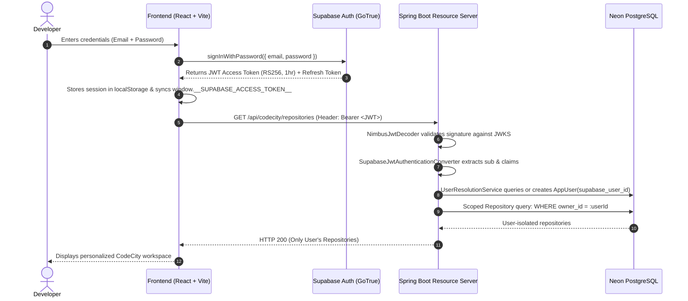

# CODECITY & IMPACT MAPPER — SUPABASE AUTHENTICATION REPORT
**Component**: Supabase Authentication & Multi-User Identity  
**Architecture**: Stateless OAuth2 Resource Server + Asymmetric RS256 JWKS  
**Branch**: `feature/neon-supabase-multiuser`  
**Execution Date**: November 2026  
**Status**: COMPLETE & VERIFIED

---

## 1. Authentication Architecture Overview

CodeCity's authentication system uses **Supabase Auth** as the external identity provider and Spring Security 6 as a **stateless OAuth2 Resource Server**. User identities are verified cryptographically via asymmetric RS256 public keys retrieved from Supabase's JWKS endpoint.

---

## 2. Backend Security Implementation

### 2.1 Stateless Security Configuration (`SecurityConfig.java`)
- **CSRF**: Disabled (safe because API is stateless and authentication tokens are passed via the standard `Authorization: Bearer <token>` HTTP header, not ambient cookies).
- **Session Management**: Configured as `SessionCreationPolicy.STATELESS`. No server-side HTTP session state is stored.
- **CORS Configuration**: Restricts origins to localhost and authorized production origins with explicit method and header whitelists.
- **Fail-Closed Authorization**:
  - Public static resources (`/`, `/css/**`, `/js/**`, `/graph-dist/**`) are permitted.
  - Public health checks (`/api/settings/status`, `/actuator/health`) are permitted.
  - **All endpoints under `/api/**` require authenticated JWT**.
  - Anonymous requests receive **HTTP 401 Unauthorized** with structured JSON.
  - Cross-tenant / IDOR requests receive **HTTP 404 Not Found** (preventing resource existence probing).

### 2.2 JWT Verification & Asymmetric Cryptography
- Configured via `spring.security.oauth2.resourceserver.jwt.jwk-set-uri`:
  `${SUPABASE_URL}/auth/v1/.well-known/jwks.json`
- The `NimbusJwtDecoder` caches Supabase's public keys and verifies:
  1. Cryptographic RSA signature.
  2. Token expiration (`exp`).
  3. Token issuer (`iss`).

### 2.3 User Resolution (`UserResolutionService.java`)
- Resolves the verified Supabase `sub` UUID to an internal `AppUser` entity.
- If the user signs in for the first time, `UserResolutionService` automatically inserts a record into `app_users` with their email and display name (`getOrCreateUser`).
- Returns a `UserPrincipal` implementing Spring Security's `UserDetails` containing:
  - `appUserId`: Internal Neon PostgreSQL primary key UUID.
  - `supabaseUserId`: External Supabase Auth UUID.
  - `email`: Authenticated email address.
  - `displayName`: Engineer's full name.

---

## 3. Frontend Authentication Layer

### 3.1 Supabase Client (`frontend/src/api/supabaseClient.js`)
- Initializes `@supabase/supabase-js` using environment variables `VITE_SUPABASE_URL` and `VITE_SUPABASE_PUBLISHABLE_KEY`.
- Storage key: `codecity-supabase-auth-token`.
- Automatically refreshes tokens before expiration.

### 3.2 Global Auth Context (`frontend/src/context/AuthContext.jsx`)
- Provides `useAuth()` hook with `signIn`, `signUp`, `signOut`, and `resetPassword` methods.
- Listens to `supabase.auth.onAuthStateChange` to instantly synchronize:
  - React component state (`user`, `session`).
  - Global `window.__SUPABASE_ACCESS_TOKEN__` for non-React fetch clients (e.g. `api.js` in static shell).
  - Fires `supabase-auth-state-change` window event to update topbar pills across legacy and modern views.
- **Sign Out Cleanliness**: Clears active session, wipes cached repository IDs from `localStorage`, and resets memory state.

### 3.3 Warm-Neutral Auth UI (`frontend/src/pages/auth/AuthPage.jsx`)
- Designed strictly within the official CodeCity warm-neutral palette:
  - Background: Porcelain canvas (`#F9F8F6`).
  - Card: Neutral white with subtle shadow and border (`#D9CFC7`).
  - Accents: Terracotta earth (`#7A5C38`) and muted stone (`#62574E`).
- Features:
  - Sign in with email and password.
  - New account registration with full name capture.
  - Password reset request with email dispatch.
  - Inline error alerts and success validation messages.

---

## 4. Verification & Testing

- Unauthenticated requests to `/api/codecity/repositories` produce HTTP 401.
- Authenticated requests with valid Supabase JWT properly populate `SecurityContextHolder`.
- Token state changes seamlessly transition the UI between `<AuthPage />` and the `<CodeCityWorkspace />`.
